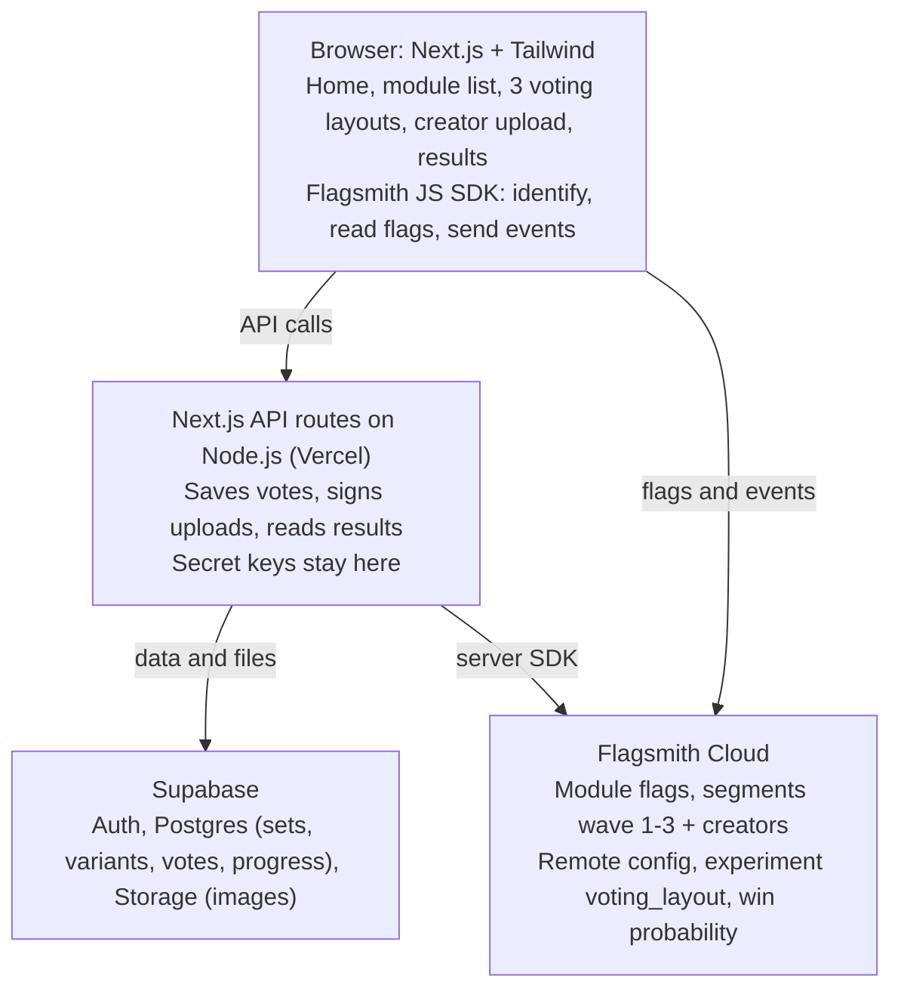
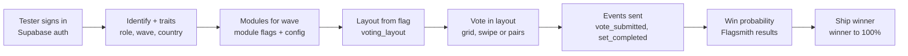

# PickLab: Track 1 project doc

Toggle Wars, the Flagsmith Experimentation Hackathon (WeMakeDevs). Online, 26 to 29 Nov 2026. Submissions close 8 PM IST on 29 Nov.

Contents: 1 Overview, 2 How Flagsmith fits, 3 Scope and build plan, 4 Risks and demo, 5 PRD, 6 DRD.

---

## 1. Overview

PickLab is a feedback app for creators. They post options (thumbnails, captions, reel captions, visuals), and testers pick the best. Flagsmith runs the product itself: it releases each module to different testers at different times, and it runs a real A/B test on how voting works.

- **Track:** Track 01, Test Something Real ($2,000). Build an app and run a real A/B test on it with Flagsmith Experimentation.
- **The question we test:** which voting layout makes testers finish the most votes: swipe cards, a 4-up grid, or head-to-head pairs?
- **Why Flagsmith is core:** without it there are no module releases, no tester segments, no layout split, no win probability and no winner rollout. Every one of those runs through a flag.
- **Testers:** 50 to 100 real people, from Discord communities, friends, X and LinkedIn. Enough to detect a large difference in completion rate, not a small one. The demo says so.
- **Build window:** 2 days of build, 1 day of real test traffic, then the demo video.

---

## 2. How Flagsmith fits

Flagsmith does two jobs. Job 1 decides who sees which module and when. Job 2 decides which voting layout each tester gets and which one wins.

### Job 1: release modules in waves

| Flagsmith feature | What it does in PickLab |
| --- | --- |
| Feature flag per module | Thumbnails, captions, reel captions and visuals each sit behind their own flag |
| Segments | Wave 1, wave 2 and wave 3 testers; creators vs testers |
| Percentage rollout | Open a module to 20%, then 50%, then 100% of testers |
| Remote config | Module title, instructions and number of options, changed without a deploy |
| Kill switch | One flip hides a module if it breaks during the test |

### Job 2: the experiment

One multivariate flag, `voting_layout`, holds three layouts. Flagsmith assigns each tester one layout, records the exposure, collects completion events and shows win probability.

| Hackathon round | What we do |
| --- | --- |
| 1. Create a flag | Multivariate flag `voting_layout`: grid (control), swipe, pairs |
| 2. Pick a metric | `set_completed`: the tester votes on every option in a set |
| 3. Split the traffic | 100% of active testers join, split evenly across the three layouts |
| 4. Ship the winner | At 90% win probability or more, roll the winner out to 100% through the same flag |

---

## 3. Scope and build plan

| Scope | In | Out |
| --- | --- | --- |
| Must | Thumbnail and caption modules, three voting layouts, tester sign-in, results page, `voting_layout` experiment, wave rollout of modules | Payments, payouts, credits |
| Should | Reel caption and visual modules (same screen, different content type), region segment, kill-switch demo | Mobile app |
| Cut | Creator marketplace, AI suggestions, fraud and bot detection, multi-org dashboards | Go on a "next" slide |

**Day 0, before 26 Nov (setup only, no product code):**

- [ ] Register on WeMakeDevs and star the Flagsmith repo
- [ ] Create a Flagsmith Cloud account, connect the managed warehouse, create one test experiment by hand
- [ ] Ask in the Flagsmith Discord whether one team can enter two tracks
- [ ] Line up 50 to 100 testers who agree to try the app on 28 Nov

**Day 1, 26 Nov:**

- [ ] Next.js app, Tailwind, Supabase auth and tables
- [ ] Generic variant-set screen (image or text options)
- [ ] Flagsmith JS SDK wired in, tester identity and traits sent on sign-in
- [ ] Module flags and segments created, waves working

**Day 2, 27 Nov:**

- [ ] Three voting layouts behind `voting_layout`
- [ ] Events `vote_submitted` and `set_completed` sent through the SDK
- [ ] Metric and experiment created and started
- [ ] Creator upload page, results page, deploy to Vercel

**Day 3, 28 Nov:** share the link, run wave 1, 2 and 3, watch results.
**Day 4, 29 Nov:** ship the winner, record the demo video, submit before 8 PM IST.

| Role | Owns |
| --- | --- |
| Frontend | Variant-set screen, three layouts, results page |
| Backend and data | Supabase schema, API routes, uploads |
| Flagsmith owner | Flags, segments, metric, experiment, waves, ship the winner |
| Growth and demo | Recruiting testers, demo script, video |

---

## 4. Risks, demo and open questions

| Risk | Impact | Mitigation |
| --- | --- | --- |
| Fewer than 50 testers show up | Experiment inconclusive | Recruit before 26 Nov; use a high-rate metric; report an honest "inconclusive" if needed |
| Experimentation is in beta | Setup breaks mid-build | Test a full experiment on Day 0; ask in the Flagsmith Discord early |
| Wrong SDK version | Events never reach Flagsmith | Use `flagsmith` JS 12.4.0+ or `@flagsmith/nodejs` 9.1.0+; old `flagsmith-nodejs` cannot send events |
| Experiment locks its flag | Can't change layouts once started | Finish all three layouts before starting the experiment |
| Results refresh every 5 minutes at most | Live demo looks frozen | Record the results page, don't demo it live |
| Competing with Flagsmith's own demo app | Looks generic | Lead with module waves and real tester data |

**Demo video (about 3 minutes):**

1. The problem: creators guess which thumbnail or caption works, and feedback tools get abandoned halfway.
2. The app: a tester signs in, sees one module, votes in one of three layouts.
3. Job 1: in Flagsmith, open the captions module to wave 2 and watch it appear for those testers, no deploy. Flip the kill switch on a module.
4. Job 2: the `voting_layout` experiment, the metric, the split, the real numbers and the win probability.
5. Ship the winner: roll the winning layout to 100% through the same flag.
6. What we learned, including what the data could not tell us.

**Open questions:**

- [ ] Can one team enter two tracks? Ask in the Flagsmith Discord.
- [ ] Is the managed warehouse included on the free Flagsmith Cloud plan?
- [ ] What does the WeMakeDevs submission form ask for (repo, video link, write-up)?
- [ ] Are we allowed to recruit testers before 26 Nov?

---

## 5. PRD

### 5.1 Problem and goals

Creators guess which thumbnail or caption will work, and the feedback tools they try get abandoned halfway. PickLab collects quick picks from real testers and finds out, with a real experiment, which voting layout gets the most feedback finished.

**Goals**

1. Ship a working app with at least two live modules (thumbnails, captions) by the end of 27 Nov.
2. Release modules to testers in three waves, controlled only through Flagsmith.
3. Run one real experiment on `voting_layout` with 50 to 100 testers and explain the result.
4. Roll the winning layout out through the same flag, and show it in a 3-minute demo video.

### 5.2 Users and user stories

| User | Who | Main need |
| --- | --- | --- |
| Creator | YouTuber, reels creator, designer | Post 2 to 4 options and see which one testers pick |
| Tester | Anyone with a link, 50 to 100 people | Vote quickly on sets of options |
| Admin | Our team | Release modules, run the experiment, ship the winner |

| ID | As a... | I want to... | So that... |
| --- | --- | --- | --- |
| US1 | Creator | upload 2 to 4 thumbnails or captions as one set | testers can pick between them |
| US2 | Creator | see pick counts per option | I know which option to use |
| US3 | Tester | sign in with one click | I can start voting fast |
| US4 | Tester | vote on a set in the layout the app shows me | giving feedback takes seconds |
| US5 | Tester | see new modules appear when they open for me | the app feels alive |
| US6 | Admin | open a module for one wave of testers | we release step by step |
| US7 | Admin | change module text without a deploy | we fix copy instantly |
| US8 | Admin | hide a broken module with one switch | testers never get stuck |
| US9 | Admin | see which layout wins and how sure we are | we decide with data |
| US10 | Admin | roll the winner out to everyone | the product improves without a release |

### 5.3 Functional requirements

| ID | Requirement | Priority | Flagsmith? |
| --- | --- | --- | --- |
| FR1 | Tester signs in (Supabase auth, magic link or Google) | Must | Identity created on sign-in |
| FR2 | Tester's identity and traits (role, wave, country) are sent to Flagsmith | Must | Yes |
| FR3 | Creator uploads a set of 2 to 4 options: images (thumbnails, visuals) or text (captions) | Must | No |
| FR4 | Home screen lists only modules whose flag is on for this tester | Must | Yes, module flags |
| FR5 | Module title and instructions come from remote config | Must | Yes |
| FR6 | Voting screen renders the layout from `voting_layout`: grid, swipe or pairs | Must | Yes, experiment |
| FR7 | Each vote is saved in Supabase and sent to Flagsmith as `vote_submitted` | Must | Yes, event |
| FR8 | Finishing a whole set sends `set_completed` | Must | Yes, metric |
| FR9 | Creator sees pick counts per option | Must | No |
| FR10 | Admin can turn a module off and it disappears within one page load | Should | Yes, kill switch |
| FR11 | Reel caption and visual modules reuse the same screen | Should | Yes, module flags |
| FR12 | Results view links to the Flagsmith experiment results | Should | Yes |

### 5.4 Non-goals and success metrics

**Not building:** payments or payouts to testers, a creator marketplace, AI-generated suggestions, fraud or bot detection, a mobile app, multi-company dashboards.

| Success metric | Target |
| --- | --- |
| Testers who sign in | 50 or more |
| Votes collected | 300 or more |
| Testers per layout | 15 or more each |
| Module waves run through Flagsmith | 3 |
| Experiment result | Win probability reported for each layout, with the credible interval explained |
| Winner shipped | Winning layout at 100% through `voting_layout` before the video |
| Code deploys needed to release a module | 0 |

---

## 6. DRD (design requirements)

### 6.1 Architecture

The browser asks Flagsmith directly which modules and layout this tester gets, and sends the vote events. Anything that needs a secret key goes through the API routes.

### 6.2 Stack per layer

| Layer | Tool | Owns |
| --- | --- | --- |
| Frontend | Next.js (App Router), React, Tailwind | Home, module list, three voting layouts, creator upload, results |
| Server | Next.js API routes on Node.js | Writes votes, signed uploads, reads results; keeps secret keys off the browser |
| Auth, database, files | Supabase | Sign-in, Postgres tables, image storage, row-level security |
| Flags and experiment | Flagsmith Cloud with managed warehouse | Module flags, segments, remote config, `voting_layout` experiment, events, win probability |
| Hosting | Vercel | Deploys from the repo |

SDKs: `flagsmith` JS 12.4.0 or newer in the browser (client-side environment key only), `@flagsmith/nodejs` 9.1.0 or newer on the server. The Flagsmith admin key lives only in the team's CLI, never in the repo.

### 6.3 Data model (Supabase)

The Supabase user id is also the Flagsmith identity, so votes and experiment exposures join on the same id.

| Table | Key columns | Notes |
| --- | --- | --- |
| `profiles` | `id` (= auth user id), `role` (creator or tester), `wave` (1, 2, 3), `country` | `role`, `wave`, `country` are also sent to Flagsmith as traits |
| `variant_sets` | `id`, `creator_id`, `module` (thumbnails, captions, reel_captions, visuals), `title`, `created_at` | One set = one question, 2 to 4 options |
| `variants` | `id`, `set_id`, `kind` (image or text), `image_path` or `text`, `position` | Images stored in a Supabase Storage bucket |
| `votes` | `id`, `set_id`, `variant_id`, `tester_id`, `layout` (grid, swipe, pairs), `created_at` | One row per pick; `layout` copied from the flag value for our own checks |
| `set_progress` | `tester_id`, `set_id`, `completed_at` | Written when a tester finishes a set; mirrors `set_completed` |

Row-level security: testers read all sets and write only their own votes; creators read vote counts only for their own sets.

### 6.4 Flagsmith setup

One Flagsmith project, two environments (Development and Production), six flags and four segments.

| Flag key | Type | Values | Purpose |
| --- | --- | --- | --- |
| `module_thumbnails` | Boolean + remote config | On or off; value = JSON with title, instructions, max options | Job 1: thumbnail module |
| `module_captions` | Boolean + remote config | Same shape | Job 1: caption module |
| `module_reel_captions` | Boolean + remote config | Same shape | Job 1: reel caption module (Should) |
| `module_visuals` | Boolean + remote config | Same shape | Job 1: visuals module (Should) |
| `voting_layout` | Multivariate | Control = `grid`; variations keyed `swipe` and `pairs` | Job 2: the experiment |
| `voting_enabled` | Boolean | On or off | Global kill switch for all voting |

| Segment | Rule | Used for |
| --- | --- | --- |
| `wave_1` | trait `wave` = 1 | First module release |
| `wave_2` | trait `wave` = 2 | Second release |
| `wave_3` | trait `wave` = 3 | Last release |
| `creators` | trait `role` = creator | Creator-only screens |

**Identities.** On sign-in the browser calls `flagsmith.identify(userId, { role, wave, country })`. Waves are assigned in rotation at sign-up and stored in `profiles.wave`.

**Rules from the docs.** Every variation needs a key, and `control` is reserved for the flag's own value. The flag is locked while the experiment runs, so all three layouts must work before it starts.

### 6.5 Events and experiment design

The primary metric is the share of exposed testers who finish a whole set (`set_completed`); a layout that makes people quit early loses.

| Event | Sent when | Sent from | Used for |
| --- | --- | --- | --- |
| Exposure | Tester's layout is read from `voting_layout` | Flagsmith SDK, automatic | Who saw which layout |
| `vote_submitted` | Tester picks an option | Browser SDK | Secondary metric: votes per tester |
| `set_completed` | Tester has voted on every option in a set | Browser SDK | Primary metric |

Event names are case-sensitive and must match the metric names in Flagsmith exactly.

| Experiment field | Value |
| --- | --- |
| Hypothesis | Swipe or pairs layouts get more sets finished than the grid |
| Flag | `voting_layout` |
| Variants | `grid` (control), `swipe`, `pairs` |
| Traffic | 100% of signed-in testers, split evenly, about 33% each |
| Primary metric | `set_completed` (conversion) |
| Secondary metric | `vote_submitted` (count per tester) |
| Minimum before deciding | 15 testers per layout; refresh results no more than every 5 minutes |
| Decision rule | Ship a layout at 90% win probability or more; otherwise keep `grid` and report inconclusive |
| Honest limit | With 50 to 100 testers only a large difference shows up; we report the credible interval, not just the winner |

### 6.6 Key flow: tester and module wave

The first four steps are Job 1 plus layout assignment. The rest is Job 2: measure, decide, ship. When the admin opens wave 2 or 3 in Flagsmith, the "Modules for wave" step changes for those testers with no deploy.
