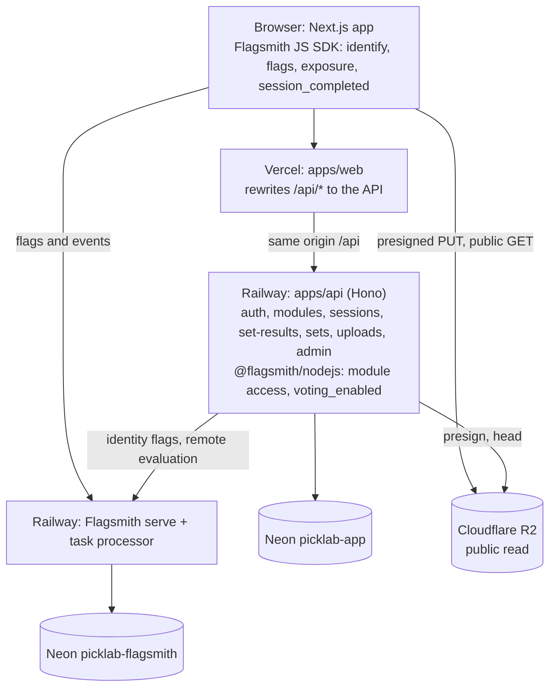

# PickLab: Technical Requirements (TRD) v2

Version 2, 16 Nov 2026. Replaces v1 (`docs/archive/TRD-v1.md`). Implements `PRD.md` v2 and decisions D1-D9 in `DUE-DILIGENCE.md`.

Rule for every choice here: few moving parts, one clean API boundary, nothing built for later.

---

## 1. Stack

| Layer | Choice | Notes |
| --- | --- | --- |
| Web | Next.js (App Router), React, Tailwind, on Vercel | All data through `/api/*`, rewritten to the API |
| API | Node.js 22, TypeScript, Hono, on Railway | One long-lived instance, no scale to zero |
| Contract | zod schemas in `packages/shared` | Single source of types for web and API |
| Database | Neon Postgres `picklab-app`, Drizzle ORM, `pg` pool | Migrations in the repo |
| Auth | Better Auth: Google for creators and admins, anonymous plugin for guests | Fallback in 4.3 |
| Images | Cloudflare R2, presigned PUT, public read | D8 |
| Flags | Self-hosted Flagsmith on Railway with its own Neon DB | `FLAGSMITH-SETUP.md`. Cloud is plan B |
| Tests | vitest, pglite (in-memory Postgres) | `TEST-CASES.md` |
| Logs | pino JSON to Railway | Request id and user id on every line |
| Repo | pnpm workspace | Section 2 |

Not used: Supabase, Redis, queues, workers, GraphQL, ClickHouse, Kafka, a state library, a component library with its own runtime, an E2E framework.

Allowed runtime dependencies (anything else needs lead approval):
`hono`, `@hono/node-server`, `zod`, `drizzle-orm`, `pg`, `better-auth`, `@flagsmith/nodejs` (>= 9.1.0), `@aws-sdk/client-s3`, `@aws-sdk/s3-request-presigner`, `pino`, `next`, `react`, `react-dom`, `tailwindcss`, `@flagsmith/flagsmith` (>= 12.4.0).
Dev: `typescript`, `vitest`, `drizzle-kit`, `@electric-sql/pglite`, `tsx`, `eslint`, `prettier`.

## 2. Folder structure

```
picklab/
├─ package.json                 scripts: dev, build, typecheck, test, lint, db:generate, db:migrate, seed, simulate
├─ pnpm-workspace.yaml
├─ tsconfig.base.json
├─ .env.example                 every variable from section 7, no values
├─ .gitignore                   .env*, flagsmith/flagsmith.env, node_modules, .next, dist
├─ README.md                    how to run locally, in 20 lines
├─ docs/                        these documents
├─ flagsmith/                   local docker-compose.yml only (Day 0)
│
├─ packages/
│  └─ shared/
│     └─ src/
│        ├─ constants.ts        MODULES, LAYOUTS, SIGNALS, limits
│        ├─ schemas.ts          zod request and response schemas for every endpoint
│        ├─ rules.ts            pure logic: validateResponses, seededShuffle, knockoutRounds, optionScores, liveStatus, parseModuleConfig
│        ├─ rules.test.ts
│        └─ index.ts
│
├─ apps/
│  ├─ api/
│  │  ├─ drizzle.config.ts
│  │  ├─ drizzle/               generated SQL migrations
│  │  ├─ src/
│  │  │  ├─ index.ts            reads env, builds real deps, serves createApp(deps)
│  │  │  ├─ app.ts              createApp({ db, flags, getUser, storage, now }): mounts routes, error handler, /healthz
│  │  │  ├─ env.ts              zod-parsed process.env, fails fast
│  │  │  ├─ auth.ts             Better Auth instance, getUser(c)
│  │  │  ├─ flags.ts            Flagsmith server client, 10 s per-identity cache, safe defaults
│  │  │  ├─ storage.ts          R2 presign and head
│  │  │  ├─ middleware.ts       requireUser, requireCreator, requireAdmin, rateLimit, requestLog
│  │  │  ├─ db/
│  │  │  │  ├─ schema.ts        Drizzle tables (section 4)
│  │  │  │  └─ client.ts        pg pool for production, pglite for tests
│  │  │  └─ routes/
│  │  │     ├─ me.ts            GET /me, POST /me/consent, DELETE /me
│  │  │     ├─ modules.ts       GET /modules
│  │  │     ├─ sessions.ts      POST /sessions, GET /sessions/:id, GET /sessions/:id/next
│  │  │     ├─ set-results.ts   POST /set-results
│  │  │     ├─ sets.ts          POST /sets, GET /sets/mine, GET /sets/:id/results, DELETE /sets/:id
│  │  │     ├─ uploads.ts       POST /uploads/sign
│  │  │     └─ admin.ts         GET /admin/live, GET /admin/overview
│  │  └─ test/
│  │     ├─ helpers.ts          makeApp(), makeUser(), makeSet(), fake flags, fake clock
│  │     └─ *.test.ts           one file per route file
│  │
│  └─ web/
│     ├─ next.config.ts         rewrites /api/* to API_ORIGIN
│     ├─ app/
│     │  ├─ layout.tsx          shell, providers
│     │  ├─ page.tsx            P-01 landing
│     │  ├─ login/page.tsx      P-02
│     │  ├─ start/page.tsx      P-05 consent
│     │  ├─ app/page.tsx                        P-06 home
│     │  ├─ app/session/[id]/page.tsx           P-07 voting
│     │  ├─ app/session/[id]/done/page.tsx      P-08
│     │  ├─ app/paused/page.tsx                 P-09
│     │  ├─ creator/page.tsx                    P-10
│     │  ├─ creator/new/page.tsx                P-11
│     │  ├─ creator/sets/[id]/page.tsx          P-12
│     │  ├─ admin/page.tsx                      P-13 stats
│     │  ├─ admin/live/page.tsx                 P-17 live
│     │  ├─ account/page.tsx                    P-14
│     │  ├─ about-test/page.tsx, privacy/page.tsx   P-15
│     │  └─ not-found.tsx, error.tsx            P-16
│     ├─ components/
│     │  ├─ ui/                 button, card, toast, modal, skeleton, badge, progress, empty-state, field
│     │  ├─ voting/             VotingFrame, GridView, SwipeView, ThisOrThatView, YesNoView, OptionMedia
│     │  ├─ home/               ModuleCard, ProgressCard
│     │  ├─ creator/            UploadSlot, TextSlot, ResultBar, SetCard
│     │  └─ admin/              LiveTable, SplitBars, StatTile
│     └─ lib/
│        ├─ api.ts              typed fetch using shared schemas, retry with backoff
│        ├─ flags.tsx           FlagsProvider: init, identify, startListening, focus refresh
│        ├─ session.ts          startSession() (reads experiment flag, D6), submitSetResult(), completeSession()
│        └─ image.ts            client-side resize to 1600 px
│
└─ scripts/
   ├─ seed.ts                   creates the seed creator and sets from scripts/seed-data/
   ├─ seed-data/                images and a sets.json
   ├─ simulate.ts               N fake visitors through the real API and the Flagsmith SDK (dry run, G2)
   └─ flagsmith-setup.sh        CLI commands that create flags, variations, segments, overrides
```

Structure rules
- A file is created only when the task that needs it runs. No empty placeholders.
- `packages/shared` has no runtime dependency except `zod`, and no I/O.
- `apps/web` never imports from `apps/api`, and the reverse. Both import `@picklab/shared`.
- Route files hold HTTP and SQL. Decision logic that needs a test lives in `packages/shared/src/rules.ts`.
- Limits: a route file under 200 lines, a component under 150. Split when exceeded, not before.

## 3. Architecture



Who decides what
- **Flagsmith decides** module access, the voting view, and whether voting is on.
- **The API enforces** module access and the kill switch using traits from our database, and owns all response data.
- **The browser** renders, reads the experiment flag once per session start (exposure), and sends `session_completed`.

Same origin: the Vercel rewrite makes API cookies first-party. `BETTER_AUTH_URL` and the Google redirect URI use the **web** origin (`https://<web>/api/auth/callback/google`). Flagsmith is a separate public host and must allow the web origin (CORS).

## 4. Data and rules

### 4.1 Tables (Neon `picklab-app`)

Better Auth owns its tables (`user`, `session`, `account`, `verification`); generate them with its CLI into `schema.ts`. Ours:

```
profiles      user_id      text pk, fk user.id on delete cascade
              role         text not null check in ('tester','creator')   default 'tester'
              wave         smallint not null check in (1,2,3)
              consented_at timestamptz null
              created_at   timestamptz not null default now()

variant_sets  id           uuid pk
              creator_id   text not null fk user.id
              module       text not null check in ('thumbnails','captions','reel_captions','visuals')
              title        text not null (1..120 chars)
              status       text not null check in ('active','deleted') default 'active'
              created_at   timestamptz not null default now()
              index (module, status)

variants      id           uuid pk
              set_id       uuid not null fk variant_sets.id on delete cascade
              kind         text not null check in ('image','text')
              image_key    text null
              text         text null (1..280 chars)
              position     smallint not null check 0..3
              unique (set_id, position)
              check ((kind='image' and image_key is not null) or (kind='text' and text is not null))

sessions      id           uuid pk
              tester_id    text not null fk user.id on delete cascade
              module       text not null
              layout       text not null check in ('grid','swipe','this_or_that','yes_no')
              target_count smallint not null check 1..20
              started_at   timestamptz not null default now()
              last_seen_at timestamptz not null default now()
              completed_at timestamptz null
              unique (tester_id, module) where completed_at is null     -- one open session per module
              index (last_seen_at)

set_results   id           uuid pk            -- generated by the client, idempotency key
              session_id   uuid not null fk sessions.id on delete cascade
              set_id       uuid not null fk variant_sets.id
              tester_id    text not null fk user.id on delete cascade
              layout       text not null
              duration_ms  integer not null check 0..600000
              created_at   timestamptz not null default now()
              unique (tester_id, set_id)
              index (set_id), index (session_id)

responses     set_result_id uuid not null fk set_results.id on delete cascade
              variant_id    uuid not null fk variants.id
              signal        text not null check in ('pick','yes','no')
              primary key (set_result_id, variant_id)
```

### 4.2 Rules

| Rule | Definition |
| --- | --- |
| Guest | First `GET /api/me` without a session creates an anonymous user and a profile. Cookie: httpOnly, secure, sameSite=lax, 1 year |
| Wave | `(count of profiles before insert) % 3 + 1`, stored once, never changes |
| Role | `tester` by default. Becomes `creator` on first Google sign-in. If a guest signs in, the guest id is kept (account linked), so the Flagsmith identity never changes |
| Admin | Signed-in email is in `ADMIN_EMAILS`. Not a role in the database |
| Module access | Server-side `getIdentityFlags(userId, { role, wave })`: module is open if its flag is enabled. Cached 10 s per identity |
| Module config | Flag value parsed as JSON `{ title, instructions, sets_per_session }`. Invalid JSON or missing fields fall back to defaults: module name, empty instructions, 5 |
| Sets left | Active sets in the module, not created by this visitor, with no `set_results` row for this visitor |
| Session start | Refuse if voting is off, module is off, consent is missing, or sets left is 0. If an open session exists for this visitor and module, return it unchanged. Else create with `target_count = min(sets_per_session, sets left)` and the layout sent by the client |
| Next set | Sets left, ordered by `md5(set_id || tester_id)`. Stable per visitor, different across visitors, no queue table |
| Option order | `seededShuffle(variants, seed = set_id + tester_id)` computed by the API and returned in the response. Same on resume |
| Valid responses | `grid`, `this_or_that`: exactly one response, signal `pick`. `swipe`, `yes_no`: exactly one response per variant of the set, each `yes` or `no`. Every `variantId` belongs to the set |
| Finish a set | One transaction: insert `set_results` (`on conflict do nothing` on both the id and `(tester_id, set_id)`), insert `responses`, update `sessions.last_seen_at`, and if finished count >= `target_count` set `completed_at`. A replay returns the same body as the first call |
| Score | Per option: `(count pick + count yes) / count(set_results for the set)` |
| Live status | `finished`: `completed_at` set. `voting`: not finished, `last_seen_at` within 2 min. `dropped`: otherwise (D7) |
| Soft delete | `variant_sets.status = 'deleted'`: hidden from queues and lists, results kept |
| Delete my data | Delete the user row; cascades remove profile, sessions, set results and responses. A creator's sets are soft-deleted first |

### 4.3 Guest fallback (only if gate G5 fails)

The API issues its own cookie `pl_guest = <uuid>.<hmac>` on first `GET /api/me`, inserts the `user` row itself with `is_anonymous = true`, and `getUser` checks this cookie before Better Auth. Everything else is unchanged because routes only depend on `getUser`.

## 5. API

Base path `/api`. JSON. Every body and response has a zod schema in `packages/shared/src/schemas.ts`. Errors: `{ "error": { "code": string, "message": string } }`.

| Method and path | Who | Request | Response |
| --- | --- | --- | --- |
| `GET /healthz` | any | | `{ ok: true }` after a DB ping |
| `ALL /api/auth/*` | any | Better Auth | Better Auth |
| `GET /api/me` | any | | `{ id, role, wave, consented, isAnonymous, isAdmin, name? }`. Creates the guest if needed |
| `POST /api/me/consent` | user | | `{ consented: true }` |
| `DELETE /api/me` | user | | `204` (Should) |
| `GET /api/modules` | user | | `{ votingEnabled, modules: [{ key, title, instructions, setsPerSession, setsLeft, openSessionId? }] }` |
| `POST /api/sessions` | consented user | `{ module, layout }` | `{ id, module, layout, targetCount, doneCount, resumed }` |
| `GET /api/sessions/:id` | owner | | same shape as above plus `completed` |
| `GET /api/sessions/:id/next` | owner | | `{ doneCount, targetCount, sets: [{ id, title, variants: [{ id, kind, imageUrl?, text? }] }] }` with 0 to 2 sets, variants already in shuffled order. Updates `last_seen_at` |
| `POST /api/set-results` | owner | `{ id, sessionId, setId, durationMs, responses: [{ variantId, signal }] }` | `{ doneCount, targetCount, sessionComplete }` |
| `POST /api/uploads/sign` | creator | `{ files: [{ contentType, size }] }` (1-4) | `{ uploads: [{ key, putUrl }] }` |
| `POST /api/sets` | creator | `{ module, title, options: [{ kind, imageKey? , text? }] }` (2-4, one kind) | `{ id }` |
| `GET /api/sets/mine` | creator | | `{ sets: [{ id, module, title, createdAt, voters, preview }] }` |
| `GET /api/sets/:id/results` | owner or admin | | `{ id, title, module, voters, options: [{ variantId, kind, imageUrl?, text?, positive, score }], byLayout? }` (`byLayout` for admins) |
| `DELETE /api/sets/:id` | owner | | `204` (Should) |
| `GET /api/admin/live` | admin | | `{ now, counters: { onSite, sessionsToday, finishedToday }, split: { grid, swipe, this_or_that, yes_no }, visitors: [{ shortId, wave, layout, module, doneCount, targetCount, status, lastSeenAt }] }` for the last hour, newest first, max 200 |
| `GET /api/admin/overview` | admin | | `{ visitorsByWave, byLayout: [{ layout, visitors, started, completed, completionRate, avgDurationMs }], responsesTotal, links: { flag, experiment, identities } }` |

Error codes

| HTTP | code | When |
| --- | --- | --- |
| 400 | `invalid_body` | zod validation failed |
| 400 | `invalid_responses` | Responses do not match the session layout or the set |
| 401 | `unauthenticated` | No user on a route that will not create a guest |
| 403 | `forbidden` | Wrong role, or not the owner |
| 403 | `consent_required` | Session or set result before consent |
| 403 | `module_off` | Module disabled for this visitor |
| 404 | `not_found` | Unknown id, deleted set, or admin route for a non-admin |
| 409 | `no_sets_left` | Nothing to vote on in the module |
| 409 | `session_closed` | Set result for a completed session |
| 413 | `file_too_large` | Upload over 5 MB |
| 415 | `unsupported_type` | Upload not png, jpg or webp |
| 429 | `rate_limited` | Over 60 set results or 20 uploads per user per minute (in-memory) |
| 503 | `voting_paused` | `voting_enabled` is off |

## 6. Flagsmith integration

Flag keys, segments and the experiment are defined in `FLAGSMITH-SETUP.md` section 4, with these changes from due diligence: `creators` segment override on for every module flag (D3); experiment split `grid` 50 / `swipe` 50 (D2, if signed off); experiment starts on the morning of 28 Nov (D1).

Browser, `apps/web/lib/flags.tsx`
```ts
import flagsmith from '@flagsmith/flagsmith';

await flagsmith.init({
  environmentID: process.env.NEXT_PUBLIC_FLAGSMITH_ENV_KEY!,   // client-side key
  api: process.env.NEXT_PUBLIC_FLAGSMITH_API,                  // https://<host>/api/v1/
  enableEvents: true,
  eventProcessorConfig: { eventsApiUrl: process.env.NEXT_PUBLIC_FLAGSMITH_EVENTS_URL },  // https://<host>/api/
  cacheFlags: true,
  defaultFlags: { voting_enabled: { enabled: true, value: null } },
});
await flagsmith.identify(me.id, { role: me.role, wave: me.wave });   // before any flag read
flagsmith.startListening(15000);                                      // plus getFlags() on window focus
```

Session start, `apps/web/lib/session.ts` (the only place the experiment flag is read)
```ts
const VARIANTS = ['swipe', 'this_or_that', 'yes_no'] as const;
const flag = flagsmith.getExperimentFlag('voting_layout');           // records the exposure
const layout = flag?.enabled && VARIANTS.includes(flag.variant) ? flag.variant : 'grid';
const session = await api.post('/api/sessions', { module, layout });
// render session.layout, never the flag, from here on
```

Session end
```ts
if (res.sessionComplete) { flagsmith.trackEvent('session_completed'); await flagsmith.flushEvents(); }
// also flushEvents() on pagehide
```

Server, `apps/api/src/flags.ts`: `@flagsmith/nodejs` in remote mode, `getIdentityFlags(userId, { role, wave })`, read `module_*` and `voting_enabled` only. 10 s cache per identity. If Flagsmith fails: use the last cached value for that identity, else modules off and voting on. Never call `getExperimentFlag` on the server.

**Verify on install, do not trust this document:** the exact names and types of `getExperimentFlag`, `flag.variant`, `eventProcessorConfig`, `startListening`, `flushEvents`, and the Better Auth anonymous plugin. Read the installed package's `.d.ts`. If a name differs, use the installed one and tell the lead.

## 7. Environments and deployment

| Where | What | Notes |
| --- | --- | --- |
| Vercel | `apps/web` | Root directory `apps/web` |
| Railway `picklab` | `api` | Health `/healthz`, pre-deploy `pnpm db:migrate`, never sleeps |
| Railway `picklab-flagsmith` | `flagsmith`, `flagsmith-task-processor`, `migrate` | Pinned image tag |
| Neon | `picklab-app`, `picklab-flagsmith` | Pooled string for the API |
| R2 | `picklab-uploads` | Public read domain; CORS allows PUT from the web origin |

| Variable | Used by | Secret |
| --- | --- | --- |
| `NEXT_PUBLIC_FLAGSMITH_ENV_KEY`, `NEXT_PUBLIC_FLAGSMITH_API`, `NEXT_PUBLIC_FLAGSMITH_EVENTS_URL` | web | No (client-side key) |
| `API_ORIGIN` | web (rewrite) | No |
| `DATABASE_URL` | api | Yes |
| `BETTER_AUTH_SECRET`, `BETTER_AUTH_URL` | api | Yes / no |
| `GOOGLE_CLIENT_ID`, `GOOGLE_CLIENT_SECRET` | api | Yes |
| `FLAGSMITH_SERVER_KEY`, `FLAGSMITH_API_URL` | api | Yes / no |
| `FLAGSMITH_DASHBOARD_URL` | api (links on Stats page) | No |
| `R2_ACCOUNT_ID`, `R2_ACCESS_KEY_ID`, `R2_SECRET_ACCESS_KEY`, `R2_BUCKET`, `R2_PUBLIC_BASE_URL` | api | Yes for the keys |
| `ADMIN_EMAILS` | api | No |

The Flagsmith admin (organisation) key exists only in the Flagsmith owner's CLI. It is never in the repo, Vercel or Railway.

## 8. Smoothness

1. **No flicker.** The voting route renders a skeleton until the session is loaded, then the session's layout.
2. **Preload.** `/next` returns two sets; the second one's images are fetched while the visitor votes.
3. **Optimistic advance.** Show the next set at once; post the set result in the background with a client-generated id; retry 3 times with backoff; toast only when all retries fail.
4. **Idempotent writes.** Section 4.2.
5. **Resume.** Open session id comes back in `/api/modules`; the home card says Continue.
6. **Kill switch.** UI reacts within 15 s (poll) or on focus; API within 10 s (cache). A `503 voting_paused` from any call routes to P-09. A `403 module_off` mid-session routes to home with a short message.
7. **Images.** Creator uploads are resized in the browser to max 1600 px before upload. No server image pipeline.
8. **Keep warm.** External ping every 4 min on the API `/healthz` and Flagsmith liveness during 28-29 Nov.

## 9. Security

- Authorization is in API middleware and queries; there is no row-level security.
- Visitors read only active sets of modules open to them, and write only their own results.
- Creators read results only for their own sets. Admin routes return 404 to everyone else.
- Uploads: allow-list png, jpg, webp; 5 MB; presigned URL valid 5 min; `POST /api/sets` checks each key exists and starts with the caller's prefix `u/<userId>/`.
- Flagsmith: change `DJANGO_SECRET_KEY` and `WAREHOUSE_CREDENTIALS_SECRET`, set `DJANGO_ALLOWED_HOSTS`, disable sign-up after the admin exists.
- Guests store an id and responses only. Creators store email and name.
- Text options are rendered as text, never as HTML.

## 10. Build order

See `HANDOVER.md` for tasks and owners. Summary: contract first (T0), then four parallel workstreams, integration at the end of each day, deploy on 27 Nov afternoon.

## 11. Open technical items

- Gates G1-G6 in `DUE-DILIGENCE.md`.
- Metrics and experiments have no CLI commands: created in the dashboard by the Flagsmith owner.
- Flagsmith liveness path (`/health/liveness`) to confirm on first deploy.
