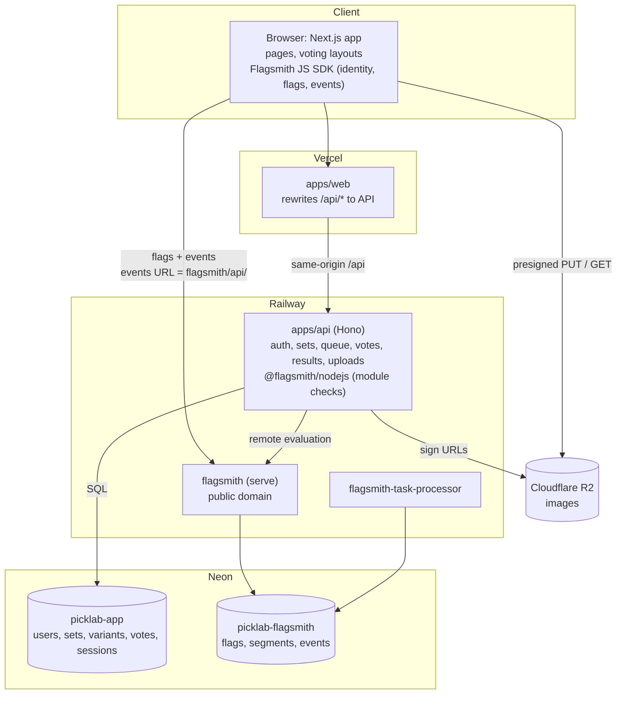

# PickLab: Technical Requirements and Architecture (TRD)

Companion: `PRD.md`, `FLAGSMITH-SETUP.md`, `FRONTEND.md`.

## 1. Stack decision

Few users, so the rule is: **few moving parts, but a clean API boundary** so frontend and backend can be built in parallel.

| Layer | Choice | Why |
| --- | --- | --- |
| Web | Next.js (App Router) + React + Tailwind, on Vercel | Fast deploys, preview URLs. All data goes through the API |
| API | Node.js 22 + TypeScript + **Hono**, on **Railway** | Small, fast, typed. A plain long-lived server keeps DB connections warm (no serverless cold starts) |
| Validation / contract | **zod** schemas in a shared package | Same types in web and API |
| DB access | **Drizzle ORM** + `pg` pool | Light, SQL-like, good Neon support, migrations in the repo |
| App database | **Neon** Postgres, project `picklab-app` | Per your choice |
| Auth | **Better Auth** (Drizzle adapter): Google sign-in for creators/admins, **anonymous plugin** for guest testers | Lives in our Postgres, no email vendor needed. Verify the plugin API with docs at build time; fallback is a signed httpOnly guest cookie issued by the API |
| Image storage | **Cloudflare R2** (S3 API, presigned uploads) | Browser uploads straight to storage, API stays light, no egress fees |
| Flags and experiment | **Self-hosted Flagsmith** on Railway + its own Neon DB `picklab-flagsmith` | See `FLAGSMITH-SETUP.md` |
| Logging | pino JSON logs to Railway | Enough for this scale |
| Repo | pnpm workspace: `apps/web`, `apps/api`, `packages/shared` | One repo, shared types |

Rejected: Supabase (replaced by Neon + own API, as you asked); separate queue/Redis/workers (nothing here needs them); microservices; GraphQL; ClickHouse/Kafka (not needed for ~100 testers).

Alternative if time runs short: fold the API into Next.js route handlers on Railway. The module boundaries below make that a copy-paste move. Default stays the separate API.

## 2. Architecture



Same-origin: Vercel rewrites `/api/*` to the Railway API, so session cookies are first-party and no CORS dance is needed. The Flagsmith host is a separate public domain; the browser talks to it directly (flags and events), and it must allow our web origin.

### Who decides what
- **Flagsmith decides** which modules a tester may see, which layout they get, whether voting is on.
- **The API enforces it** (a hidden module is refused server-side even if the UI is tampered with) and is the source of truth for votes.
- **The browser** shows the UI, reads the layout, and sends the exposure and `session_completed` with the same user id.

## 3. Deployment topology

| Where | What | Notes |
| --- | --- | --- |
| Vercel | `apps/web` | Env: `NEXT_PUBLIC_FLAGSMITH_ENV_KEY` (client-side key only), `NEXT_PUBLIC_FLAGSMITH_API`, `NEXT_PUBLIC_FLAGSMITH_EVENTS_URL`, `API_ORIGIN` for rewrites |
| Railway project `picklab` | service `api` | Health `/healthz`, restart on failure, pre-deploy `drizzle migrate` |
| Railway project `picklab-flagsmith` | `flagsmith`, `flagsmith-task-processor`, `migrate` | Pinned image tag, env vars in `FLAGSMITH-SETUP.md` |
| Neon | `picklab-app`, `picklab-flagsmith` | Two projects/DBs so events never slow the app. Pooled string for the API |
| R2 | bucket `picklab-uploads` | Public read via custom domain or signed GET; CORS allows PUT from the web origin |

API env: `DATABASE_URL`, `BETTER_AUTH_SECRET`, `BETTER_AUTH_URL`, `GOOGLE_CLIENT_ID/SECRET`, `FLAGSMITH_SERVER_KEY` (server-side environment key), `FLAGSMITH_API_URL`, `R2_ACCOUNT_ID`, `R2_ACCESS_KEY_ID`, `R2_SECRET_ACCESS_KEY`, `R2_BUCKET`, `ADMIN_EMAILS`. The Flagsmith **admin/org API key lives only in the team's CLI**, never in the repo or Railway.

## 4. Data model (Neon `picklab-app`)

The auth user id is also the Flagsmith identity.

```
users            id (pk, from Better Auth), email null for guests, name, is_anonymous, created_at
profiles         user_id (pk, fk), role ('creator'|'tester'), wave (1|2|3), consented_at
variant_sets     id (uuid), creator_id (fk), module ('thumbnails'|'captions'|'reel_captions'|'visuals'),
                 title, status ('active'|'deleted'), created_at
variants         id (uuid), set_id (fk), kind ('image'|'text'), image_key | text, position (0..3)
sessions         id (uuid), tester_id (fk), layout ('grid'|'swipe'|'this_or_that'|'yes_no'),
                 module, target_count, started_at, last_seen_at, completed_at null
set_results      id (uuid, client generated = idempotency key), session_id (fk), set_id (fk),
                 tester_id (fk), layout, duration_ms, created_at
                 UNIQUE (tester_id, set_id)          -- one finished set per visitor
responses        set_result_id (fk), variant_id (fk), signal ('pick'|'yes'|'no')
                 PRIMARY KEY (set_result_id, variant_id)
```
A finished set is written in one transaction: one `set_results` row plus its `responses` (grid/this-or-that: one `pick`; swipe/yes-no: a `yes` or `no` per option). Option score for creators = (picks + yes) / visitors who finished that set. `sessions.layout` is fixed at session start, so a weight change in Flagsmith never switches a visitor mid-session. `last_seen_at` (updated on each request) powers the Live page.

Rules and indexes
- `UNIQUE (tester_id, set_id)` with `ON CONFLICT DO NOTHING` makes retries safe.
- Constraint: 2 <= variants per set <= 4 (checked in API in one transaction).
- Index `votes (set_id, variant_id)` for results; `votes (tester_id)`; `variant_sets (module, status)`.
- Authorization is in the API (no row-level security): testers read active sets of modules enabled for them and write only their own votes; creators read results only for their own sets; admin = emails in `ADMIN_EMAILS`.
- Wave assignment: round-robin when the profile is created (`count(profiles) % 3 + 1`), stored in `profiles.wave`.
- Guests: a `users` row with `is_anonymous = true` is created on first visit and its id is kept in an httpOnly cookie (1 year). The same id is the Flagsmith identity, so a returning guest keeps their wave and layout. If a guest later signs in with Google, keep the guest id (link the account) so the identity never changes mid-experiment.
- Swipe card order: shuffle per (tester, set) with a seeded shuffle, so position bias averages out and a resume shows the same order.

## 5. API (Hono, JSON, zod-validated, all under `/api`)

| Method + path | Who | Purpose |
| --- | --- | --- |
| `GET /healthz` | any | Liveness + DB ping |
| `/api/auth/*` | any | Better Auth (Google, anonymous guest session) |
| `GET /api/me` | user | Id, role, wave, consent state. Creates the guest + profile if none |
| `POST /api/me/consent` | user | Record consent before the first vote |
| `GET /api/modules` | tester | Modules enabled for this identity + their remote config (server-side Flagsmith identity eval, cached 30 s per user). Honors `voting_enabled` |
| `POST /api/sessions` | tester | Start or resume a session: layout (from the client-read flag, recorded), builds the queue of `sets_per_session` unvoted sets for enabled modules |
| `GET /api/sessions/:id/next` | tester | Next set with variants and signed image URLs; also returns the one after it for preloading |
| `POST /api/set-results` | tester | `{ id, sessionId, setId, durationMs, responses: [{ variantId, signal }] }`. Idempotent. Validates signals match the session's layout. Returns `{ remaining, sessionComplete }`. Refuses if module off or voting disabled |
| `GET /api/admin/live` | admin | Visitors seen in the last hour: short id, wave, layout, module, progress, status, last seen. Polled every 5 s |
| `POST /api/uploads/sign` | creator | Presigned PUT URLs (type + size limits, up to 4) |
| `POST /api/sets` | creator | Create a set from uploaded keys or texts |
| `GET /api/sets/mine` | creator | List own sets with totals |
| `GET /api/sets/:id/results` | creator/admin | Picks per option, voters, per-layout split |
| `DELETE /api/sets/:id` | creator | Soft delete |
| `GET /api/admin/overview` | admin | Testers by wave, sessions by layout, votes, completion per layout, Neon-vs-Flagsmith sanity numbers |

Error shape `{ error: { code, message } }`. Rate limit votes and uploads per user (in-memory limiter is enough for one instance).

## 6. Flagsmith integration in code

Browser (`apps/web`)
```ts
import flagsmith from '@flagsmith/flagsmith';           // >= 12.4.0
await flagsmith.init({
  environmentID: NEXT_PUBLIC_FLAGSMITH_ENV_KEY,          // client-side key
  api: NEXT_PUBLIC_FLAGSMITH_API,                        // https://<flagsmith-host>/api/v1/
  enableEvents: true,                                    // required, or init throws with eventProcessorConfig
  eventProcessorConfig: { eventsApiUrl: NEXT_PUBLIC_FLAGSMITH_EVENTS_URL },  // https://<flagsmith-host>/api/
  cacheFlags: true,                                      // last known flags if Flagsmith is slow
  defaultFlags: { voting_enabled: { enabled: true, value: null } },
});
await flagsmith.identify(user.id, { role, wave });      // BEFORE reading any experiment flag

// voting screen only (React): records the exposure
import { useExperiment } from '@flagsmith/flagsmith/react';
const flag = useExperiment('voting_layout');            // null until flags load -> show skeleton
const VIEWS = ['swipe', 'this_or_that', 'yes_no'] as const;
const layout = flag?.enabled && VIEWS.includes(flag?.variant) ? flag.variant : 'grid';   // branch on variant key; unknown = control

// live updates without reload (documented: startListening(ticks))
flagsmith.startListening(15000);

// after API says sessionComplete:
flagsmith.trackEvent('session_completed'); await flagsmith.flushEvents();
```
Option and method names above are taken from the docs pages (`eventProcessorConfig.eventsApiUrl`, `useExperiment`, `flag.variant`, `trackEvent`, `flushEvents`, `cacheFlags`, `defaultFlags`). The full return type of the experiment flag is not documented: check the SDK types on install. Next.js App Router wiring: client `FlagsmithProvider` from `@flagsmith/flagsmith/react` with an instance from `createFlagsmithInstance()` (`@flagsmith/flagsmith/isomorphic`). Skip server-side flag state: the identity is only known in the browser session and the experiment needs the browser to record the exposure.

Server (`apps/api`): `@flagsmith/nodejs` >= 9.1.0 in **remote** mode, `getIdentityFlags(userId, traits)` to decide module access and `voting_enabled`; cache per identity for 30 s. Never `getExperimentFlag` on the server (the browser records the exposure where the user actually sees the variation).

Event rules
- `session_completed` only when the API returns `sessionComplete: true`. Name is case-sensitive, identical to the metric. Votes per tester and time per vote are read from our `votes` table, so no second Flagsmith event is needed.
- `flushEvents()` before navigating away and on `pagehide`.
- The identity id sent to Flagsmith equals `users.id`, so Neon votes join to Flagsmith exposures.

## 7. Making it smooth (the "function" part)

1. **Flags first, no flicker**: a small `FlagsProvider` blocks the voting route behind a skeleton until `identify` and the flags resolve. Cached flags + `defaultFlags` avoid a blank app if Flagsmith is slow.
2. **Preload**: `GET /sessions/:id/next` returns the next two sets; images are prefetched while the tester votes. Use `next/image`-style sized variants or R2 image resizing so mobile does not download 4 MB thumbnails; creators' uploads are resized client-side to max 1600 px before upload.
3. **Optimistic UI**: show the next set instantly after a tap; send the vote in the background with a client-generated id; retry with backoff; show a small "saving..." state only if retries fail.
4. **Idempotent writes**: unique `(tester_id, set_id)`, so double taps and retries never double count.
5. **Resume**: leaving and returning continues the open session at the same set.
6. **Kill switch behaviour**: module flag off -> module disappears on next flag refresh (focus event + 60 s poll) and API refuses votes for it; `voting_enabled` off -> "voting paused" screen, no errors.
7. **Server cache**: 30 s per-identity cache of Flagsmith results, cleared on login. Keep the API instance alive (no scale to zero) so DB pool and caches stay warm.
8. **Cold start guard**: `/healthz` pings Neon; UptimeRobot-style ping every 5 min during the test window if the Neon plan sleeps.
9. **Uploads**: presigned direct-to-R2 PUT, max 5 MB per file, allow-list png/jpg/webp, API verifies the objects exist before creating the set.
10. **Observability**: pino logs with request id + user id; `/api/admin/overview` shows layout counts so you can see sample-ratio problems early.

## 8. Security

- Client-side Flagsmith key in the browser only; server key only in API env; admin key only in the CLI.
- Change `DJANGO_SECRET_KEY` and `WAREHOUSE_CREDENTIALS_SECRET` from the compose defaults; set `DJANGO_ALLOWED_HOSTS`; close Flagsmith sign-up after the admin account exists.
- Cookies: httpOnly, secure, sameSite=lax. CSRF: same-origin plus Better Auth defaults.
- Upload type/size limits, presigned URLs expire in minutes, set creators cannot read other creators' results.
- Privacy: guests have no email or name stored, only an id and votes; creators have email and name. Show the consent text (FRONTEND page P-05). Testers can request deletion.

## 9. Reconciliation and testing

- Dry run before test day: simulate 120 users (results need 50 identities per arm) across both layouts through the real API and SDK, confirm exposures and `session_completed` show in Flagsmith results, then delete the throwaway experiment/data.
- Check query for the demo: `select layout, count(distinct tester_id) testers, count(*) filter (where completed) ...` over `sessions`, compared with Flagsmith's exposure counts.
- Minimum automated tests: vote idempotency, queue excludes already-voted sets, module-off refusal. Plain `vitest`, no extra frameworks.

## 10. Build order (maps to the hackathon days)

1. Day 0: Flagsmith local + Railway + Neon DBs + dry run (see `FLAGSMITH-SETUP.md`).
2. Day 1: monorepo, auth, profiles, sets/variants, uploads, `/modules`, FlagsProvider, grid layout, flags + segments + waves.
3. Day 2: swipe layout, sessions + votes + events, creator results, admin overview, seed 20+ sets per module, create metrics and **then** the experiment, deploy.
4. Days 3-4: waves, monitor, end experiment, roll winner, demo.

## 11. Open technical items

- Confirm the experiment flag's TypeScript type on install (section 6).
- Confirm Better Auth + Hono adapter usage and the anonymous plugin at implementation time.
- Metrics and experiments have no documented CLI commands: create them in the dashboard (or `flagsmith api`).
- Neon plan limits for scale-to-zero on the Flagsmith DB.
- Whether the self-hosted Flagsmith Postgres warehouse returns win probability (Day 0 gate).
